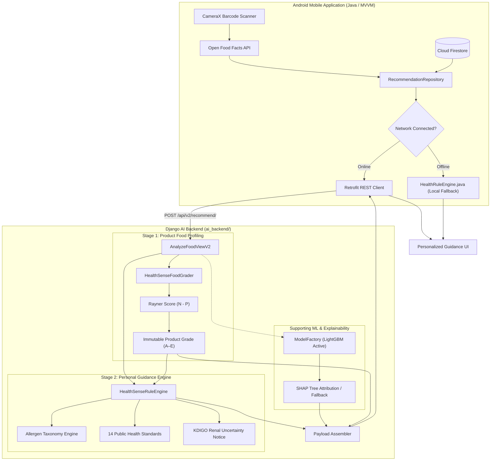

# HealthSense AI 🥑 — Intelligent Food Analysis & Dietary Guidance System

> **A Decoupled Two-Stage Hybrid Decision-Support System for Multi-Member Families**  
> *MCA Mini Project | Production-Grade Native Android Client & Django AI/ML Backend*

[](https://www.djangoproject.com/)
[](https://www.django-rest-framework.org/)
[](https://developer.android.com/)
[](https://www.oracle.com/java/)
[](https://www.python.org/)
[](https://lightgbm.readthedocs.io/)
[](https://xgboost.readthedocs.io/)
[](https://firebase.google.com/)
[](https://world.openfoodfacts.org/)

---

## 📑 Table of Contents

- [Project Identity & Overview](#-project-identity--overview)
- [The Core Decoupled Architectural Paradigm](#-the-core-decoupled-architectural-paradigm)
- [Feature Implementation Matrix](#-feature-implementation-matrix)
- [Technology Stack & Specifications](#-technology-stack--specifications)
- [System Architecture & Data Flow](#-system-architecture--data-flow)
- [Empirical Machine Learning Benchmarks](#-empirical-machine-learning-benchmarks)
- [Nutritional Profiling Methodology](#-nutritional-profiling-methodology)
- [Personalized Guidance & Clinical Safety Engine](#-personalized-guidance--clinical-safety-engine)
- [REST API Reference Summary](#-rest-api-reference-summary)
- [Installation & Quick Start](#-installation--quick-start)
- [Testing & Build Verification](#-testing--build-verification)
- [Documentation Index](#-documentation-index)
- [Academic Context & Defense Summary](#-academic-context--defense-summary)
- [Disclaimers & Limitations](#-disclaimers--limitations)
- [License](#-license)

---

## 📖 Project Identity & Overview

**HealthSense AI** is an intelligent food analysis and personalized dietary decision-support system designed to assist households and individuals in making informed food choices. 

Consumers frequently encounter packaged foods with complex nutritional labels, obscure chemical additives, and misleading marketing claims. While several mobile scanners provide a single, universal product score, real households consist of multi-generational individuals with diverse, often conflicting health considerations: an adult managing Type 2 Diabetes requires strict glycemic control; an elderly member with hypertension requires low sodium; a young child must avoid high stimulants and excessive sugars; and an allergic child requires absolute avoidance of specific allergens.

HealthSense AI solves this through a **two-tier architecture**:
1. A **Native Android Mobile Application** providing high-speed barcode scanning (CameraX + ML Kit), direct Open Food Facts integration, multi-member family profile management (Cloud Firestore), and a client-side deterministic safety rule engine for offline resilience.
2. A **Python / Django REST AI Backend** executing two-stage nutritional profiling, 14 statutory public health standards (WHO, Codex Alimentarius, FSSAI, AAP, EFSA, KDIGO, ADA, AHA), pluggable ML classifiers (LightGBM, XGBoost, Random Forest, Logistic Regression), and SHAP explainability.

> [!NOTE]
> **Academic Project Status**: Developed as an MCA Mini Project. HealthSense AI is an educational decision-support research application; it is **not** a commercially marketed medical device or clinically certified diagnostic tool.

---

## ⚖️ The Core Decoupled Architectural Paradigm

A foundational scientific principle enforced throughout HealthSense AI is the **Decoupled Two-Stage Boundary**:

> **"Product grade belongs to the product; personalized guidance belongs to the person."**

```
┌────────────────────────────────────────────────────────┐
│ STAGE 1: PRODUCT-LEVEL FOOD PROFILE (Nutri-Score FSA)  │
│ - Evaluates packaged food per 100g / 100ml             │
│ - Energy, Sugars, Sat Fat, Sodium vs Fiber, Protein    │
│ - Completely independent of who purchases or eats it   │
│ - IMMUTABLE Output: Product Grade (A, B, C, D, E)      │
└───────────────────────────┬────────────────────────────┘
                            │
                            ▼
┌────────────────────────────────────────────────────────┐
│ STAGE 2: PERSON-LEVEL PERSONALIZED GUIDANCE            │
│ - Evaluates individual member's age, allergies, health │
│ - Applies hard allergen overrides and health rules     │
│ - NEVER mutates or alters the Stage 1 Product Grade    │
│ - Output: Member Guidance (REGULAR, OCCASIONAL, AVOID) │
└────────────────────────────────────────────────────────┘
```

A whole-grain peanut snack has an intrinsically favorable nutritional density per 100g (**Grade C**). If scanned for a family with a peanut-allergic child, the product grade **remains Grade C**, while the child receives an unambiguous **`AVOID`** safety advisory with a critical risk score (100). The product grade is never artificially downgraded to Grade E merely because one individual cannot consume it.

---

## ✅ Feature Implementation Matrix

| Feature | Subsystem | Implemented Status | Verification Method |
|---|---|:---:|---|
| **Live Camera Barcode Scanner** | Android | **Implemented** | CameraX + Google ML Kit `BarcodeScanning` at 30 FPS |
| **Open Food Facts Lookup** | Android | **Implemented** | Retrofit2 REST client fetching product composition & images |
| **Nutritional Facts Breakdown** | Android | **Implemented** | Material 3 card layout displaying energy, macro, and micronutrients |
| **Stage 1 Product Grading (A–E)** | Django / Android | **Implemented** | Nutri-Score Rayner/FSA balancing algorithm per 100g |
| **Multi-Member Family Profiles** | Android | **Implemented** | Cloud Firestore reactive CRUD with isolated user security |
| **Allergen Taxonomy Engine** | Django / Android | **Implemented** | 9+ major allergen classes with trace vs. confirmed differentiation |
| **Evidence-Based Health Rules** | Django / Android | **Implemented** | 14 public health standards (WHO, ADA, AHA, AAP, KDIGO) |
| **Mandatory CKD Uncertainty** | Django / Android | **Implemented** | Strict KDIGO rule flagging omitted potassium/phosphorus |
| **Pluggable ML Classification** | Django | **Implemented** | LightGBM, XGBoost, Random Forest, Logistic Regression |
| **SHAP Feature Attribution** | Django | **Implemented** | Local feature explanations with feature importance fallback |
| **Client-Side Offline Fallback** | Android | **Implemented** | `HealthRuleEngine.java` handles full analysis if network drops |
| **Dynamic Backend URL Config** | Android | **Implemented** | In-app preferences to switch between Emulator, LAN, or Cloud |
| **Firebase Email/Password Auth** | Android | **Implemented** | Firebase Authentication with input validation |
| **R8 Code & Resource Shrinking** | Android | **Implemented** | Verified via successful `gradlew assembleRelease` build |

---

## 🛠️ Technology Stack & Specifications

### Android Mobile Client
- **Platform**: Native Android (Android Studio Hedgehog to Koala)
- **Language & Runtime**: Java (Source/Target Compatibility: JavaVersion.VERSION_17, compiled with OpenJDK 21)
- **Target SDK**: 35 | **Minimum SDK**: 24 (Android 7.0+) | **Compile SDK**: 35
- **Architecture**: MVVM with Repository Pattern, ViewBinding, and Reactive LiveData
- **Hardware Vision**: AndroidX CameraX `1.3.4` + Google ML Kit Barcode Scanning `17.3.0`
- **Networking**: Square Retrofit `2.11.0`, OkHttp `4.12.0`, Google Gson `2.11.0`, Glide `4.16.0`
- **Cloud Services**: Firebase BoM `33.2.0` (Firebase Auth & Cloud Firestore)

### Python Django AI/ML Backend (`ai_backend/`)
- **Language**: Python 3.11.9 (Compatible with 3.10 to 3.12)
- **Web Framework**: Django 5.1.15, Django REST Framework 3.17.2, Django CORS Headers 4.9.0
- **Machine Learning**: LightGBM `4.7.0`, XGBoost `3.2.0`, Scikit-Learn `1.9.0`, Joblib `1.5.3`
- **Explainability & Data Processing**: SHAP `0.51.0`, Pandas `2.2.3`, NumPy `2.4.6`, PyYAML `6.0.3`
- **Automated Testing**: Pytest `9.1.1`, AnyIO `4.14.2`

---

## 🏗️ System Architecture & Data Flow



> [!IMPORTANT]
> **Firestore Isolation**: The Android client connects directly to Cloud Firestore via the Firebase Android SDK using user-authenticated rules. The Django backend is a stateless computational service that never reads, writes, or stores user profiles.

---

## 📊 Empirical Machine Learning Benchmarks

The V1 baseline classifiers were trained on **3,428 unique products** cleaned from Open Food Facts, paired with **8 standardized clinical profiles** (27,424 total observations), and evaluated on a **20% held-out test set (5,485 observations)** with zero barcode leakage:

| Model | Accuracy | Macro F1 | Macro Precision | Macro Recall | ROC-AUC (OVR) | Avoid False Negative Rate | Latency |
|---|:---:|:---:|:---:|:---:|:---:|:---:|:---:|
| **Logistic Regression** | 70.04% | 0.6660 | 0.6682 | 0.6649 | 0.8578 | 40.42% | 0.001 ms |
| **Random Forest** | 95.39% | 0.9480 | 0.9517 | 0.9446 | 0.9922 | 9.61% | 0.023 ms |
| **XGBoost** | 97.12% | 0.9671 | 0.9693 | 0.9651 | 0.9973 | 6.81% | 0.004 ms |
| **LightGBM (Active)** 🏆 | **97.47%** | **0.9712** | **0.9733** | **0.9693** | **0.9978** | **6.40%** | **0.013 ms** |

> [!CAUTION]
> **Scientific Interpretation**: The 97.47% accuracy indicates that LightGBM successfully learned and reproduced the programmed rule-based labeling logic. It **does NOT** represent medical efficacy, clinical trial ground truth, or health outcome verification.

---

## 🥗 Nutritional Profiling Methodology

HealthSense AI implements the peer-reviewed **Nutri-Score Rayner / FSA Nutrient Profiling Model**:

### Mathematical Formulation
$$\text{Score} = N - P$$

- **Unfavorable Points ($N$, 0 to 40)**: Energy density (kJ), total sugars (g), saturated fatty acids (g), and sodium (mg) per 100g.
- **Favorable Points ($P$, 0 to 15)**: Dietary fiber (g), protein (g), and fruits, vegetables, legumes, nuts (FVLN %).
- **The Balancing Rule**: If $N \ge 11$, protein is only subtracted if $\text{FVLN} \ge 5$ points (preventing ultra-processed snacks from masking negative nutrients with added protein). Cheeses are exempt.
- **Beverages**: Evaluated on a dedicated beverage scale with water unconditionally assigned Grade A.

| Grade | Rayner Score | Scientific Interpretation | Typical Examples |
|:---:|:---:|:---|:---|
| **A** | $\le -1$ | More favorable nutritional profile | Whole rolled oats, plain lentils, water |
| **B** | $0 \le \text{Score} \le 2$ | Generally favorable nutritional profile | Whole-wheat bread, plain low-fat yogurt |
| **C** | $3 \le \text{Score} \le 10$ | Mixed / intermediate profile | Peanut butter, cheddar cheese, hummus |
| **D** | $11 \le \text{Score} \le 18$ | Less favorable profile | Sweetened flavored yogurts, potato chips |
| **E** | $\ge 19$ | Least favorable profile | Confectionery chocolate bars, energy drinks |
| **INSUFFICIENT DATA** | N/A | Missing core nutrients ($< 3$ reported) | Unlabeled packaged goods |

*For full formulas, thresholds, and beverage logic, see [docs/NUTRITIONAL_METHODOLOGY.md](docs/NUTRITIONAL_METHODOLOGY.md).*

---

## 🛡️ Personalized Guidance & Clinical Safety Engine

Stage 2 applies 14 statutory public health standards (`config/evidence_standards.yaml`):

1. **Hard Allergen Overrides**: Declared allergens (e.g. peanuts, tree nuts, milk, gluten, egg, soy, fish, shellfish, sesame) trigger an immediate **`AVOID`** (`risk_level: CRITICAL`, `risk_score: 100`).
2. **Precautionary Trace Notices**: Distinguishes confirmed presence from precautionary statements ("may contain").
3. **Pediatric Contraindications**: Caffeine drinks and energy drinks are strictly contraindicated for children $< 12$ years (EFSA 2015).
4. **Mandatory CKD Uncertainty Notice**: Standard food labels omit potassium and phosphorus. Under KDIGO 2020 guidelines, digital data is clinically insufficient; the app issues an explicit clinical uncertainty notice.
5. **Sugar Semantics**: Differentiates Total Sugars from Free Sugars (WHO 2015) and flags Added Sugars as `Unknown` when omitted on manufacturer packaging.

---

## 🔌 REST API Reference Summary

### Primary Endpoint: `POST /api/v2/recommend/`
Evaluates packaged food composition against multi-member family profiles.

```bash
curl -X POST http://localhost:8000/api/v2/recommend/ \
  -H "Content-Type: application/json" \
  -d '{
    "product": {
      "barcode": "8901030932456",
      "product_name": "Quaker Rolled Oats",
      "nutriments": {"calories": 389.0, "sugars": 1.0, "sodium": 5.0, "fat": 6.9, "saturated_fat": 1.2, "protein": 16.9, "fiber": 10.6}
    },
    "family_members": [
      {"id": "m1", "name": "Alex", "age": 45, "health_conditions": ["Diabetes (Type 2)"], "allergies": []}
    ]
  }'
```

*For complete request schemas, response examples, and legacy V1 routes, see [docs/API_REFERENCE.md](docs/API_REFERENCE.md).*

---

## 🚀 Installation & Quick Start

### 1. Django AI Backend (Python 3.11)
```powershell
# Navigate to backend
cd ai_backend

# Create and activate virtual environment
python -m venv venv
.\venv\Scripts\Activate.ps1   # On Linux/macOS: source venv/bin/activate

# Install dependencies
pip install -r requirements.txt

# Run migrations and system check
python manage.py migrate
python manage.py check

# Start development server on all interfaces
python manage.py runserver 0.0.0.0:8000
```

### 2. Android Mobile Application (Android Studio / Gradle)
```powershell
# In repository root:
$env:JAVA_HOME = "C:\Program Files\Android\Android Studio\jbr"

# Run Android unit tests:
.\gradlew.bat testDebugUnitTest

# Assemble Debug APK:
.\gradlew.bat assembleDebug

# Output APK: app/build/outputs/apk/debug/app-debug.apk
```

*For detailed physical device setup, Firebase configuration, and firewall rules, see [docs/INSTALLATION.md](docs/INSTALLATION.md).*

---

## 🧪 Testing & Build Verification

The application was independently tested and verified across all subsystems:

```
[✓] Android Unit Tests: 4/4 passing (HealthRuleEngineTest.java) in 18s
[✓] Android Debug Build: assembleDebug SUCCESSFUL in 1m 38s (34 MB APK)
[✓] Android Release Build: assembleRelease SUCCESSFUL in 1m 06s with R8 minification (26 MB APK)
[✓] Django System Check: 0 issues identified
[✓] Backend Pytest Suite: 106 automated tests passing in 8.52s
[✓] Zero Secret Leakage: Confirmed via security audit
```

*Full testing details and platform notes are documented in [docs/TESTING.md](docs/TESTING.md).*

---

## 📚 Documentation Index

| Document | Description |
|---|---|
| [docs/ARCHITECTURE.md](docs/ARCHITECTURE.md) | Detailed decoupled two-stage architecture and component contracts |
| [docs/INSTALLATION.md](docs/INSTALLATION.md) | Verified step-by-step setup for Android Studio, JDK, and Django |
| [docs/API_REFERENCE.md](docs/API_REFERENCE.md) | Full REST API manual with JSON payloads and error codes |
| [docs/DATASETS_AND_ML.md](docs/DATASETS_AND_ML.md) | Open Food Facts dataset cleaning, 27,424 observations, and ML benchmarks |
| [docs/NUTRITIONAL_METHODOLOGY.md](docs/NUTRITIONAL_METHODOLOGY.md) | Mathematical formulation of Nutri-Score Rayner/FSA scoring and safety rules |
| [docs/TESTING.md](docs/TESTING.md) | Comprehensive test suite report, build outputs, and verification results |
| [docs/SECURITY_AND_PRIVACY.md](docs/SECURITY_AND_PRIVACY.md) | Privacy-by-design, data minimization, and threat modeling |
| [docs/DEPLOYMENT.md](docs/DEPLOYMENT.md) | Production deployment via Gunicorn, Docker, and signed release APK |
| [docs/TROUBLESHOOTING.md](docs/TROUBLESHOOTING.md) | Solutions for common networking, emulator, and build pitfalls |
| [docs/LIMITATIONS.md](docs/LIMITATIONS.md) | Regulatory status, clinical uncertainty, and database limitations |
| [docs/PROJECT_REPORT.md](docs/PROJECT_REPORT.md) | Academic MCA project report summary and viva defense guide |
| [docs/screenshots/README.md](docs/screenshots/README.md) | Screen inventory and guide for capturing authentic device screenshots |

---

## 🎓 Academic Context & Defense Summary

- **Project**: Master of Computer Applications (MCA) Mini Project
- **Developer**: Amit Chame ([amitchame19@gmail.com](mailto:amitchame19@gmail.com))
- **Core Contribution**: A decoupled decision-support architecture resolving the multi-member family dilemma through independent product profiling and personalized guidance.

---

## ⚠️ Disclaimers & Limitations

1. **Not a Medical Device**: HealthSense AI is an informational tool and does not provide clinical diagnosis or prescription.
2. **Renal Diets (CKD)**: Nutrition facts panels omit potassium and phosphorus; patients must consult their nephrologist.
3. **Severe Allergies**: Digital data cannot guarantee the absence of hidden cross-contact. Users with severe allergies must inspect physical product packaging.

---

## 📄 License

This repository is licensed under the **Academic & Educational Evaluation License (All Rights Reserved)**. See [LICENSE](LICENSE) for terms governing academic review and open-source third-party attributions.
