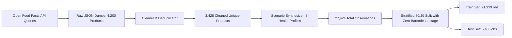

# HealthSense AI — Datasets, Machine Learning & Benchmark Documentation

## 1. Dataset Origin & Data Provenance

HealthSense AI utilizes crowdsourced packaged food information from the **Open Food Facts** international database, supplemented by nutrient reference standards from the **USDA FoodData Central** foundation datasets.

- **Primary Source**: [Open Food Facts API](https://world.openfoodfacts.org/)
- **Data License**: Open Database License (ODbL) v1.0 / Database Contents License (DbCL) v1.0
- **Ingestion Method**: REST API search queries targeting major retail product categories (breakfast cereals, breads, beverages, snacks, dairy, plant-based alternatives, prepared foods).
- **Attribution**: "Data contributed by Open Food Facts community contributors (https://world.openfoodfacts.org/)".

---

## 2. Ingestion, Cleaning & Preprocessing Pipeline

The ingestion and preparation pipeline is defined in `ai_backend/src/data/` and `ai_backend/src/preprocessing/`:

### 2.1 Cleaning Rules & Deduplication
- **Deduplication**: Identified duplicates by primary barcode (`code`) and canonicalized product names.
- **Nutrient Range Validation**: Plausibility filters enforced per 100g:
  - $0 \le \text{energy\_kcal} \le 900$ kcal
  - $0 \le \text{sugars} \le 100$ g
  - $0 \le \text{fat} \le 100$ g
  - $0 \le \text{saturated\_fat} \le 100$ g
  - $0 \le \text{protein} \le 100$ g
  - $0 \le \text{sodium} \le 40,000$ mg
  - Energy conversion: Where only `energy-kj_100g` was reported, kilocalories were derived via $\text{kcal} = \frac{\text{kJ}}{4.184}$.
- **Text Normalization**: Stripped HTML entities, packaging artifacts, bracketed ingredient percentages, and language prefixes.

### 2.2 Missing Data Treatment
- **Missing != Zero**: In V2, missing core nutrients are never coerced to zero.
- **Reporting Metrics** (from `dataset_summary.json`):
  - Energy: 0.20% missing
  - Total Sugars: 0.03% missing
  - Saturated Fat: 0.50% missing
  - Fiber: 22.78% missing (common on packaging where fiber disclosure is voluntary)
  - Sodium: 0.18% missing

---

## 3. Synthetic Multi-Profile Training Dataset (V1 Baseline)

To train the V1 baseline classification models, each of the **3,428 unique products** was paired with **8 standardized clinical/demographic scenarios**, producing exactly **27,424 observations**:

| Profile Index | Scenario Identifier | Target Demographic / Conditions | Label Distribution |
|:---:|:---|:---|---|
| 1 | `General_Healthy` | Adult, no chronic illnesses, no allergies | 2,372 Rec / 1,056 Caution / 0 Avoid |
| 2 | `Diabetic_Patient` | Type 2 Diabetes (Sugar sensitive) | 1,694 Rec / 659 Caution / 1,075 Avoid |
| 3 | `Hypertensive_Patient` | Hypertension (Sodium sensitive) | 1,225 Rec / 1,290 Caution / 913 Avoid |
| 4 | `High_Cholesterol_Patient` | Hyperlipidemia (Saturated fat sensitive) | 1,368 Rec / 920 Caution / 1,140 Avoid |
| 5 | `Peanut_Allergic` | IgE-mediated peanut allergy | 2,287 Rec / 1,011 Caution / 130 Avoid |
| 6 | `Dairy_Allergic` | Milk protein allergy / lactose intolerance | 1,467 Rec / 533 Caution / 1,428 Avoid |
| 7 | `Celiac_Gluten_Allergic`| Celiac disease / wheat-gluten sensitivity | 1,527 Rec / 612 Caution / 1,289 Avoid |
| 8 | `Diabetic_Hypertensive_Senior` | Senior (age 68) with co-morbidities | 1,694 Rec / 659 Caution / 1,075 Avoid |

### Overall Label Distribution across 27,424 Rows:
- **`RECOMMENDED`**: 13,634 (49.72%)
- **`CAUTION`**: 6,740 (24.58%)
- **`AVOID`**: 7,050 (25.71%)

---

## 4. Machine Learning Models & Quantitative Benchmarks

Four classification algorithms were implemented behind a common `BaseHealthSenseModel` interface:
1. **Logistic Regression**: Linear baseline with balanced class weights (`max_iter=1000`).
2. **Random Forest**: Ensemble of 100 decision trees (`max_depth=12`, `class_weight='balanced'`).
3. **XGBoost**: Gradient boosted trees (`learning_rate=0.1`, `max_depth=6`, `subsample=0.8`).
4. **LightGBM**: Leaf-wise gradient boosting (`learning_rate=0.1`, `num_leaves=31`, `n_estimators=100`).

### Empirical Benchmark Results on 20% Held-Out Test Set (5,485 observations):
*(Zero barcode leakage confirmed across train/test splits)*

| Model | Accuracy | Macro F1 | Macro Precision | Macro Recall | ROC-AUC (OVR) | Avoid False Negative Rate | Latency |
|---|:---:|:---:|:---:|:---:|:---:|:---:|:---:|
| **Logistic Regression** | 70.04% | 0.6660 | 0.6682 | 0.6649 | 0.8578 | 40.42% | 0.001 ms |
| **Random Forest** | 95.39% | 0.9480 | 0.9517 | 0.9446 | 0.9922 | 9.61% | 0.023 ms |
| **XGBoost** | 97.12% | 0.9671 | 0.9693 | 0.9651 | 0.9973 | 6.81% | 0.004 ms |
| **LightGBM (Active)** 🏆 | **97.47%** | **0.9712** | **0.9733** | **0.9693** | **0.9978** | **6.40%** | **0.013 ms** |

---

## 5. Critical Scientific Interpretation of ML Metrics

> [!CAUTION]
> **What the 97.47% Accuracy Actually Measures:**
> The 97.47% accuracy achieved by LightGBM reflects the model's ability to **interpolate and reproduce internally programmed nutritional rules**.
> It **DOES NOT** represent medical efficacy, clinical validation, or ground truth derived from clinical trial outcomes.

### Architectural Evolution from V1 to V2:
- **In V1**: ML models attempted to directly predict a final tripartite label (`RECOMMENDED`, `CAUTION`, `AVOID`) from combined product and user features.
- **In V2**: The system recognizes that clinical dietary safety must be deterministic and transparent. V2 uses an evidence-informed statutory rule engine (`config/evidence_standards.yaml`) for safety-critical decisions, reserving ML models and SHAP as a supporting generalizer and feature attribution tool.

---

## 6. SHAP Feature Attribution & Explainability

HealthSense AI integrates **SHAP (SHapley Additive exPlanations)** via `HealthSenseShapExplainer` (`src/explainability/shap_explainer.py`):
- Uses `shap.TreeExplainer` on tree-based models (LightGBM, XGBoost, Random Forest).
- Extracts top positive risk contributors (nutrients increasing the probability of `AVOID`) and protective factors (nutrients supporting `RECOMMENDED`).
- **Defensive Graceful Fallback**: If SHAP or its underlying JIT dependencies (`llvmlite`/`numba`) are restricted on the host platform, the module seamlessly falls back to intrinsic model feature importances, ensuring zero server downtime.
